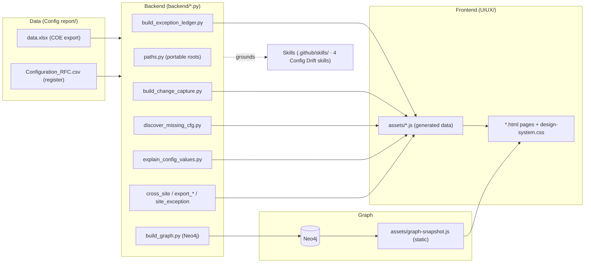

# Config Drift Governance

A self-contained, transferable package for the **P&G PrIME WMS Config Drift**
governance system: the Python **backend** that turns the COE drift export into
governed insight, the **knowledge graph**, the clickable **frontend** (HTML/CSS/JS,
no build step), and the decision **skill**.

Everything is portable — paths auto-resolve to this folder, so a new developer can
`unzip` (or clone), `pip install`, run one build command, and open the UI.

---

## What this system does

Config Drift scores every warehouse site against a Standard Configuration Library.
This package makes the result **governable**:

- **Exception ledger** — for every configuration value at least one site has
  *accepted*, who accepted it, under which CFG-RFC (or none → a governance gap),
  and which peer sites still have it open (adoptable).
- **Change capture** — what is *new* since the last scan (new deviations, new
  sites/fields/values, new CFG-RFCs) and its impact on the governance graph.
- **Missing-CFG discovery** — accepted deviations that carry no CFG record, with a
  grounded, human-reviewed suggestion of the governing CFG-RFC.
- **Cross-site inconsistencies** — the same value accepted here but penalised there.
- **Plain-English explanations** — every deviation and value explained from the
  site's own words (Deviation Notes / Rationale), nothing invented.
- **Knowledge graph** — the whole thing as a Neo4j graph, with a static snapshot
  the frontend renders without a database.

---

## Architecture



**Data flow:** `Config report/data.xlsx` + `Configuration_RFC.csv` → **backend**
scripts → `UIUX/assets/*.js` → the **frontend** HTML renders them. The graph is
built into Neo4j by `build_graph.py`; the frontend reads a static **snapshot** so
it works with no database.

---

## Folder layout

```
config-drift-governance/
├─ README.md                 ← you are here
├─ requirements.txt          ← Python dependencies
├─ .env.example              ← copy to .env (all optional; auto-detect by default)
├─ build.py                  ← ONE command: rebuild all frontend data (offline)
│
├─ docs/
│   └─ ARCHITECTURE.md       ← how it all fits (diagrams + tool→asset→UI map)
│
├─ backend/                  ← all Python
│   ├─ paths.py              ← single source of truth for filesystem paths
│   ├─ build_exception_ledger.py   → assets/exception-ledger.js
│   ├─ build_change_capture.py     → assets/change-capture.js
│   ├─ discover_missing_cfg.py     → assets/discovered-cfg.js
│   ├─ explain_config_values.py    → assets/config-meanings.js
│   ├─ tag_potential_exceptions.py → assets/potential-exceptions.js
│   ├─ site_exception_report.py    → assets/site-exception-report.js
│   ├─ export_cross_site_ui.py     → assets/cross-site.js
│   ├─ export_drift_ui.py          → assets/drift-actions.js
│   ├─ cross_site_exceptions.py    → Config report/cross_site_*.csv
│   ├─ xlsx_to_deviations_csv.py   → Config report/all_sites_deviations.csv
│   ├─ build_graph.py + *_graph.py ← Neo4j graph builders (opt-in)
│   ├─ cfg_decision.py / crfc_*.py ← governance decisions + register
│   ├─ explain_ij.py / explain_deviations.py / enrich_deviations.py
│   ├─ pbi_drift_alert.py / sharepoint_reader.py / *replica*.py  ← live connectors (optional)
│   └─ _diag_*.py / _probe_*.py     ← ad-hoc diagnostics
│
├─ Config report/           ← data (inputs + generated outputs)
│   ├─ data.xlsx            ← INPUT: the COE Config Drift export
│   ├─ Configuration_RFC.csv← INPUT: the CFG-RFC change/exception register
│   └─ *.csv / *.json       ← GENERATED by the backend (regenerated by build.py)
│
├─ UIUX/                    ← frontend (open any .html directly, no build step)
│   ├─ index.html, knowledge-graph.html, config-drift-actions.html, …
│   ├─ assets/              ← design-system.css, shell.js, bot.js, and the
│   │                         generated *.js data files the pages read
│   ├─ skills/              ← platform SKILL.md packages (browsable in the UI)
│   └─ docs/                ← platform technical design (MD + HTML)
│
└─ .github/skills/          ← the 4 Config Drift skills integrated into the UI
    ├─ config-drift-human-decision/       ← HITL decision layer (+ ledger_grounding.json)
    ├─ config-drift-deviation-explainer/  ← Layer-1 + LLM explainer
    ├─ config-drift-grounded-explainability/ ← the [MOCA]/[PRIME]/[CRFC] citation method
    └─ prime-config-drift-governance/     ← domain knowledge (deviations, CFG-RFC, gates)
```

---

## Quickstart

### 1. Install
```powershell
cd config-drift-governance
python -m pip install -r requirements.txt
```

### 2. (Optional) configure
Everything auto-detects this folder, so you can skip this. To override the data
location or wire up Neo4j / live connectors:
```powershell
Copy-Item .env.example .env      # then edit .env
```

### 3. Rebuild the frontend data (offline, no database)
```powershell
python build.py            # runs every asset builder in order
python build.py --list     # see the stages first
```

### 4. View the UI
Open **`UIUX/index.html`** (or **`UIUX/knowledge-graph.html`**) in a browser.
The pages load the freshly generated `assets/*.js` — no server required.

> Tip: for a nicer local experience you can serve the folder:
> `python -m http.server 8000 -d UIUX` then browse to `http://localhost:8000`.

---

## The knowledge graph

- **Static (default):** the frontend renders `UIUX/assets/graph-snapshot.js` /
  `knowledge-graph.json` — no database needed to view.
- **Live rebuild:** set `NEO4J_URI` / `NEO4J_USER` / `NEO4J_PASSWORD` (in `.env`),
  start Neo4j, then:
  ```powershell
  python build.py --graph          # or:  python backend/build_graph.py
  ```
  `build_graph.py` loads the register, deviations and links, writes a provenance
  `(:Snapshot)` node, diffs against the previous snapshot, and verifies every
  headline number against a real Cypher path.

---

## Portability — how paths work

There are **no hardcoded machine paths**. [backend/paths.py](backend/paths.py) resolves
the workspace root as the parent of `backend/` (i.e. this package). Scripts use:

```python
from paths import WORKSPACE as ONEDRIVE
COE = os.path.join(ONEDRIVE, "Config report", "data.xlsx")
OUT = os.path.join(ONEDRIVE, "UIUX", "assets", "exception-ledger.js")
```

Override the data location by setting `WHS_WORKSPACE` (or a `.env`), otherwise it
just works after copying the folder anywhere.

---

## Optional / external connectors

These are **not** needed to build or view the UI (the shipped `data.xlsx` is the
source). They pull drift straight from live systems and require corporate access:

| Script | Needs | Purpose |
|--------|-------|---------|
| `pbi_drift_alert.py` | Power BI dataset + MSAL auth | pull drift live instead of the xlsx |
| `sharepoint_reader.py` | SharePoint + MSAL auth | read the config catalogue pages |
| `validate_against_replica.py`, `replica_drift.py` | SQL replica + Diamond `db.py` | benchmark against the replica DB |

Point them at their systems via the env vars documented in
[.env.example](.env.example) (e.g. `PBI_DATASET_ID`, `SP_LOGIN_HINT`,
`DIAMOND_DB_PATH`).

---

## The skills (integrated into the UI)

Four Config Drift skills live in [.github/skills/](.github/skills) and are surfaced by
the Config Drift Assistant in the UI:

| Skill | Role |
|-------|------|
| [config-drift-human-decision](.github/skills/config-drift-human-decision/SKILL.md) | **HITL decision layer** — discover the governing CFG-RFC for an unbacked accepted deviation, review AI-proposed attachments, record ACCEPT / REASSIGN / RAISE / REJECT / DEFER. Grounded by `ledger_grounding.json`. |
| [config-drift-deviation-explainer](.github/skills/config-drift-deviation-explainer/SKILL.md) | **Two-layer explainer** — Layer-1 deterministic + Layer-2 grounded LLM, change-watched. |
| [config-drift-grounded-explainability](.github/skills/config-drift-grounded-explainability/SKILL.md) | **Citation method** — tags every claim `[MOCA]`/`[PRIME]`/`[CRFC]`/`[PYTHON]`/`[GENERAL]`. |
| [prime-config-drift-governance](.github/skills/prime-config-drift-governance/SKILL.md) | **Domain knowledge** — deviation types, Config vs Health Score, CFG-RFC lifecycle, Design Review / CAR / CHR gates, 2014→2022 migration. |

> See [docs/ARCHITECTURE.md](docs/ARCHITECTURE.md) for the full picture — diagrams and
> the tool → generated-asset → UI mapping.

---

## Regenerating from a fresh export

1. Replace `Config report/data.xlsx` with the new COE export (keep the sheet
   name and columns).
2. `python build.py` — every asset and CSV is regenerated.
3. (Optional) `python build.py --graph` to refresh the Neo4j graph + snapshot.
4. Refresh the browser.


## Published copy

This public copy holds the **code only**. Data assets under `UIUX/assets/` (site deviations, exception ledger, discovered configuration, change capture, graph snapshot) and the `Config report/` inputs are generated locally by `python build.py` from your own Config report and are not published. The **RTCIS ↔ PrIME 2014 ↔ 2022** tab of `UIUX/knowledge-graph.html` works offline from `assets/rtcis-prime-views.js` (views exported from the Cosmos graph) and live with `tools/kg_api.py` of the `RTCIS-PrIME Knowledge Graph` folder. Internal host names are masked (`<sharepoint-host>`, `<replica-host>`): set your own in `backend/sharepoint_reader.py` (`SP_HOST`) and `backend/.env`.
