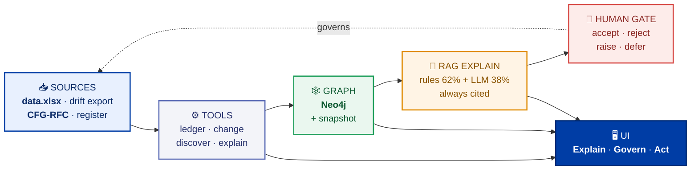
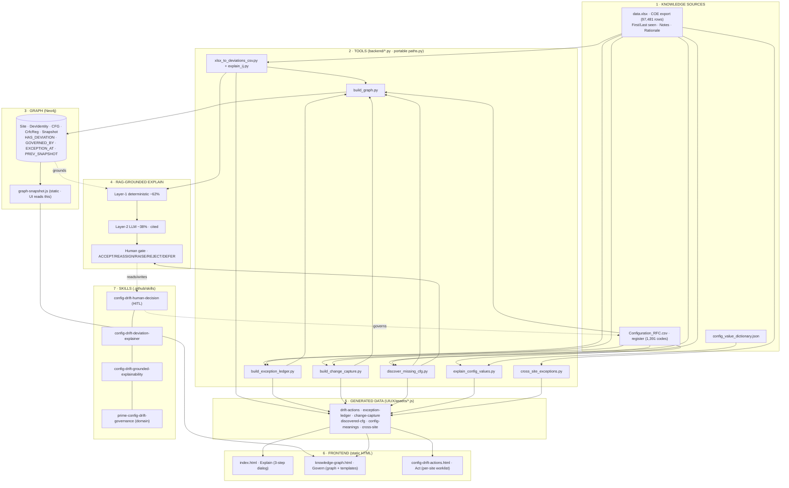

# Config Drift Governance — Architecture

How the pieces fit: **knowledge sources → tools → knowledge graph → RAG-grounded
explanation → human decision → UI**, with every claim cited and the ungovernable
residual explicitly handed to a person.

---

## At a glance

**One line:** raw drift in → tooled + graphed → explained with citations → a human
decides → three UI views (Explain / Govern / Act), and every decision writes back to
keep the register honest.

---

## Detailed flow

---

## 1 · Knowledge sources

| Source | What it is | Key fields |
|---|---|---|
| `Config report/data.xlsx` | COE Config Drift export — 97,481 rows | `A value` / `R value`, `First seen on` / `Last seen on`, `Deviation Notes`, `Rationale for Accepted` |
| `Config report/Configuration_RFC.csv` | CFG-RFC change / exception **register** — 1,391 codes | Request/Decision Status, CAB dates, Closed Date |
| `Config report/config_value_dictionary.json` | editable value-meaning lexicon | human text per attribute |

**Governance rule:** an *Accepted* deviation must be backed by a CFG-RFC. An unbacked
acceptance is a governance gap, not a pass.

## 2 · Tools → generated data → UI

Every backend script (run in order by `build.py`) reads the sources and writes one
frontend data file. Nothing is hand-authored downstream.

| Tool (`backend/`) | Generates | Consumed by |
|---|---|---|
| `xlsx_to_deviations_csv.py` + `explain_ij.py` | `Config report/all_sites_deviations*.csv` (A-vs-R, cited) | feeds the other builders |
| `export_drift_ui.py` | `assets/drift-actions.js` | **Act** page + Home dialog |
| `build_exception_ledger.py` | `assets/exception-ledger.js` + `ledger_grounding.json` (skill) | **Govern** tab + Home dialog |
| `build_change_capture.py` | `assets/change-capture.js` | **Govern** tab (What changed) |
| `discover_missing_cfg.py` | `assets/discovered-cfg.js` | **Govern** tab (missing-CFG review) |
| `explain_config_values.py` | `assets/config-meanings.js` | Home dialog + Govern |
| `cross_site_exceptions.py` → `export_cross_site_ui.py` | `assets/cross-site.js` | **Govern** tab (cross-site) |
| `site_exception_report.py` | `assets/site-exception-report.js` | site exception report |
| `build_graph.py` | Neo4j graph + `assets/graph-snapshot.js` | **Govern** graph |

Rebuild everything offline: `python build.py` (add `--graph` to also rebuild Neo4j).

## 3 · Capture change (delta since last scan)

`build_change_capture.py` uses the export's `First seen` / `Last seen`, so change is
**native, not guessed**:
- **NEW** (first-seen in window), **RESOLVED** (last-seen before latest scan), **NEW/updated CRFC** (register dates in window).
- Each new deviation is classed by graph impact: `NEW_GOVERNED` · `NEW_ADOPTABLE` · `NEW_ADOPTABLE_PEER` · `NEW_GAP`.

## 4 · Graph

`build_graph.py` is one sustainable command — stages **register → deviations → link →
snapshot → diff → verify**:
- **Nodes:** `Site/PcdSite`, `DevIdentity`, `CFG`, `CrfcReg`, `Snapshot`.
- **Edges:** `HAS_DEVIATION`, `GOVERNED_BY`, `EXCEPTION_AT`, `REGISTERED_AS`, `PREV_SNAPSHOT`.
- **Provenance + change-aware:** each run writes a `(:Snapshot)` (source sha1, rows, mtime), diffs the previous snapshot, and **verifies every headline number against a real Cypher path** (fails loudly otherwise).
- The UI reads the static `assets/graph-snapshot.js` — no database needed to view.

## 5 · RAG-grounded explanation (two layers + human gate)

- **Layer-1 (deterministic, ~62%):** resolves against register + graph + rules; formatting-vs-functional diff; splits accepted rows into HEALTHY / STALE / ORPHAN / UNBACKED.
- **Layer-2 (LLM, ~38%):** grounded natural-language explanation; every claim tagged `[MOCA]` data model · `[PRIME]` product behaviour · `[CRFC]` register · `[PYTHON]` how classified · `[GENERAL]` domain knowledge.
- **Discovery cascade** (`discover_missing_cfg.py`): PEER_PRECEDENT → NOTE_REFERENCE → SAME_SITE_SIBLING → REGISTER_TITLE → NONE, each with a strength; honest about the weak tail.
- **Human gate** (`cfg_decision.py`): one verdict per row — ACCEPT / REASSIGN / RAISE / REJECT / DEFER — with guardrails (no anonymous decisions, no rubber-stamping weak evidence, register-validity warnings, append-only audit).

## 6 · Skills (integrated, in `.github/skills/`)

| Skill | Role |
|---|---|
| `config-drift-human-decision` | The **HITL decision layer** — govern accepted deviations that carry no CFG-RFC. AI proposes, CoE disposes; append-only audit. Grounded by `ledger_grounding.json`. |
| `config-drift-deviation-explainer` | The **two-layer explainer** — Layer-1 deterministic classification + Layer-2 grounded LLM, change-watched so it re-grounds when inputs change. |
| `config-drift-grounded-explainability` | The **citation method** — turns each A-vs-R deviation into plain English where every claim is tagged to its source. |
| `prime-config-drift-governance` | The **domain knowledge** — deviation types, Config vs Health Score, CFG-RFC lifecycle, Design Review / CAR / CHR gates, 2014→2022 migration. |

## 7 · Frontend (static HTML, no build step)

| View | Page | What it does |
|---|---|---|
| **Explain** | `UIUX/index.html` | Guided *"Why is this a deviation?"* dialog — Site → Finding → Why, over `WHS_DRIFT`, enriched with value meanings + the ledger. |
| **Govern** | `UIUX/knowledge-graph.html` | Two tabs (Ontology · Config/CRFC & Drift); the Config tab has query templates: CFG-RFC register · Cross-site inconsistencies · What changed · Exception ledger (accept / re-open / suggest CRFC). |
| **Act** | `UIUX/config-drift-actions.html` | Per-site prioritized worklist (P1/P2/P3/MONITOR/IGNORE), grouped by action, each finding with A/R diff, cited grounding tags and AI explanation. Surfaced as the **Config Drift Assistant's** output. |

---

## Design principles

- **Nothing invented** — every number traces to a Cypher path or a source cell.
- **Honest about confidence** — weak evidence is labelled, not promoted.
- **Human owns the residual** — the ungovernable case is handed to a person, not guessed.
- **Portable** — no hardcoded paths; `python build.py` regenerates everything offline.
