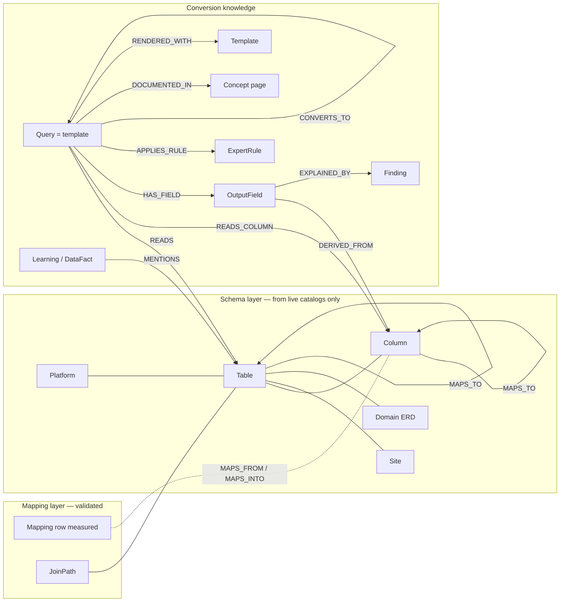
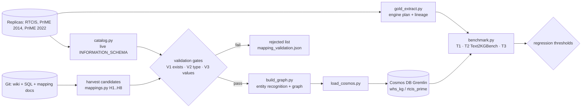

# Architecture — RTCIS / PrIME 2014 / PrIME 2022 knowledge graph

**Goal.** One validated knowledge graph of every table and column of the three warehouse engines, how they map onto each
other, and how queries were converted — so that (1) a person or an agent can convert a query between engines with evidence,
and (2) in the future, write a new query from a natural-language question on any of the three databases.

**Rule that governs everything:** nothing enters the graph unless it was checked against a real database first.
Documents propose; the database decides.

---

## 1. What is in the graph (`rtcis_prime`)



| Layer | Content (2026-11-21) | Validated how |
|---|---|---|
| Schema | 1,680 tables, 28,585 columns: RTCIS (Euskirchen + London) 583 / 7,255; PrIME 2014 (Xiqing) 491 / 9,107; PrIME 2022 (Euskirchen DE08 base tables + replica views) 606 / 12,223 | `INFORMATION_SCHEMA` of the base databases (synonyms resolved to `*_simp` / `*_RTDS`); per-site presence kept (`EXISTS_AT`) |
| Descriptions | PrIME table/column descriptions, primary keys, theme (Configuration / Master Data / Transactional), ERD domain | attached **only** where the object exists in a real catalog. The vendor data model lists 1,026 PrIME 2022 tables that are not in the replica — they are kept out |
| Mappings | 9,033 validated mappings: RTCIS→PrIME 2022 158, RTCIS→PrIME 2014 147, PrIME 2014→2022 8,728 (incl. data-model renames); plus 221 edges from the Euskirchen measured mapping table = 9,254 `MAPS_TO` | V1 both endpoints exist, V2 type family, V3 live value lookup (§4). **54 documented mappings rejected** (e.g. `invact→invmov` columns that `invmov` does not have, `ord.ship_id`, `car`) |
| Conversion | 17 RPM queries × 2 engines, 212 output fields, 68 findings, 12 expert rules, 57 learnings, 27 data facts, 52 wiki pages, 5 templates | queries executed on RTCIS Euskirchen, PrIME DE08 and Athens; fields checked by `field_check.py`; entities recognised in SQL kept only if in the catalog (5 extractor errors held back) |

Full ontology (labels, properties, edge domain/range): [relationships/ontology.json](../relationships/ontology.json).

---

## 2. Pipeline (rebuild, never hand-edit)



* **Git is the source of truth** (wiki, SQL templates, field notes). The graph is a derived, rebuildable index — the same
  discipline as the LLM-wiki pattern this knowledge base already follows. A wrong edge is fixed in the source, then rebuilt.
* **Gold comes from the engines**, not from our own parser: `SET SHOWPLAN_XML` (tables/columns the engine reads) and
  `sys.dm_exec_describe_first_result_set` (which column feeds each output field). The extractor is not graded with itself.
* **Benchmark as a regression gate** (Text2KGBench metrics + conversion accuracy): run on every rebuild; a drop blocks publish.

---

## 3. Hosting study

| Option | Fit for this graph | Security / platform | Retrieval for natural language | Verdict |
|---|---|---|---|---|
| **Azure Cosmos DB for Apache Gremlin** (account in the UVAWHEU dev resource group, Gremlin enabled, was empty) | ✅ traversals tested live (benchmark T3, NL lookups); 75k elements; shared autoscale throughput | ⚠️ data plane through **account keys** — Microsoft's Gremlin security guidance names managed identities for calling services but no Entra data-plane RBAC, while the platform is moving to Entra ID. Public network access is **enabled** on the account (guidance: private endpoints only) | ❌ no vector search → pair with Azure AI Search | **Use now** as the traversal store, behind one backend identity |
| Azure Cosmos DB for NoSQL (graph as adjacency documents) | ⚠️ multi-hop = several queries; no Gremlin | ✅ Entra data-plane RBAC, local auth can be disabled | ✅ built-in vector search | Fallback if InfoSec forbids key-based access |
| Graph in Microsoft Fabric | ✅ Microsoft's suggested target for OLAP graph / Gremlin migration | ✅ Entra | ⚠️ analytics-oriented | Watch; good for BI-side graph analytics |
| Neo4j (today: local Desktop, holds config drift) | ✅ best tooling (Cypher, Bloom, GraphRAG libraries) | ⚠️ self-hosted / licence; not a platform service today | ✅ vector index | Keep as dev / exploration tool, not as the shared service |
| Timbr (existing semantic layer) | ⚠️ business ontology over SQL, not a cross-engine mapping store | ✅ SSO | ✅ NL→SQL agent already used for KPIs | **Complement**: Timbr answers business questions; the graph feeds it mapping knowledge |

**Recommendation.** Cosmos Gremlin as the traversal store + **Azure AI Search** (the platform already runs one) as the
entry-point index — hybrid GraphRAG: search finds the starting nodes (tables, columns, templates, learnings) from the
question; Gremlin expands their neighbourhood (mappings, join paths, rules, findings); the LLM writes SQL; the SQL is
**compiled / executed on the real replica before it is shown** (same rule as §4). Ask the platform team to
(1) hold the account key in the tenant Key Vault, read only by the backend managed identity, and (2) disable public network
access / add a private endpoint. Re-evaluate Cosmos NoSQL if key-based access is not accepted.

---

## 4. Validation gates (applied before loading)

| Gate | Check | Result 2026-11-21 |
|---|---|---|
| V1 exists | both endpoints in the live catalog of their engine | 9,033 pass, 54 rejected |
| V2 type | same data-type family (text / number / date) | 38 type differences flagged on the edge (e.g. RTCIS numeric id → PrIME nvarchar) |
| V3 values | up to 200 sampled source values looked up in the target column (same site Euskirchen RTCIS → DE08 where possible) | 182 curated column mappings checked. Same-site confirmed: `item_config.itmcod→prtmst.prtnum` 100%, `locatn.locatn→locmst.stoloc` 97%, `sysdtl.itmcod→dlytrn.prtnum` 96.5%. 0% with ≤ 50 distinct values = **code set differs** (`whsflg` Y/N → `stk_flg` 0/1, `trntyp→actcod`, `qastat` RL→U): needs a value mapping. 0% on identifiers (orders, transaction ids) = different history on the DEV copy, not comparable yet |
| Conflicts | one source column → different targets in different sources | `sysdtl.locatn` → `dlytrn.frstol` **and** `tostol`; both kept, a person decides |
| Entities from SQL | recognised table/column must exist in the catalog | 5 extractor errors kept out |
| Queries | executed on RTCIS Euskirchen, PrIME DE08, PrIME Athens | 51 runs ok (wiki results) |

---

## 5. Separate graphs by theme, or one graph?

**Best practice: one database, one graph per bounded context, shared identifiers between them — neither one giant graph nor
one database per theme.**

* Gremlin cannot traverse across containers, so a split must follow the traversals: everything one question walks through
  stays together. Schema + mappings + conversion + templates are walked together ("query → column → MAPS_TO → PrIME column
  → learning") → **one graph `rtcis_prime`**.
* **Config drift** has a different source (COE export + CFG-RFC register), owners, refresh cadence and consumers, and only a
  few touch points (site code, PrIME config tables such as `poldat`) → **its own graph `config_drift`** in the same database.
  Link by shared keys (`Site:<code>`, `Table:prime:poldat`) in the application, not by edges.
* Same database with **shared autoscale throughput** (max 1,000 RU/s, bills 100–1,000): small graphs do not each pay a minimum.
* One container per theme gives independent rebuilds (drop + reload one theme), access scoping and a smaller blast radius.
* Partition key `/pk`: `Table:<engine>` / `Column:<engine>` for the schema, the label for the rest; point reads always pass `pk`.

**Query templates.** SQL text stays in **Git** (reviewed, versioned, diffable); the graph holds the template **metadata** —
intent, parameters, tables read, output-field lineage, grade, validated runs, file path — on `Query` vertices; the intent text
is also indexed in AI Search for retrieval. The graph is not the system of record for SQL.

Config drift: `tools/export_config_drift.py` (Neo4j → JSON) then `load_cosmos.py --graph config_drift`. **Not loaded yet:**
the Neo4j DBMS holding it was not running, and its replica validator covers only the Policy Maintenance section today.

---

## 6. How users reach it (existing UIs first)

| User | Surface (existing) | What they do | Integration |
|---|---|---|---|
| Site key user / analyst | **Teams bot on the Ultimate Platform** (UVAWHEU workflows, like the Europe NPI assistant) | "Convert this RTCIS query", "how do I get pallet height in PrIME 2022?" → answer card: SQL, evidence, confidence, *validated on <site>* | new LangGraph workflow: `search (AI Search) → expand (Gremlin) → write SQL → validate on replica (describe_first_result_set / TOP n) → card`. Backend identity reads the Cosmos key from Key Vault. **Designed, not built or deployed** — needs your approval |
| Developer / converter | **VS Code agents** (RTCIS→PrIME SQL Remediation agent, LLM wiki) | conversion with the full method + benchmark | the agent calls `tools/` Gremlin lookups (`templates/gremlin_queries.md`) and follows the wiki method |
| Governance / COE | **WHS GenAI UI** (`config-drift-governance/UIUX`, Knowledge section) | browse mappings, rejected mappings, templates, validation status | page `rtcis-prime-graph.html` + generated snapshot (`tools/export_ui_snapshot.py`; no database needed to view) |
| Business questions on live data | **Timbr agent** (existing) | KPI questions | feed validated mappings / learnings into the Timbr knowledge base; Timbr stays the NL→SQL engine for business KPIs |

---

## 7. Future natural-language query writing (target flow)

1. **Entity linking**: question → AI Search over node cards (table/column descriptions, template intents, learnings) → top-k nodes, filtered by the user's engine and site (`EXISTS_AT`).
2. **Graph expansion** (Gremlin, 1–2 hops): columns, join paths, value mappings (edges marked `CODE SET DIFFERS` carry the translation need), expert rules, findings for empty fields.
3. **Template first**: if a validated template's intent matches, adapt its parameters instead of writing from scratch.
4. **Write SQL** with the house rules (OBS1–8, WHT/FAN/LOC/VIEW) injected from `ExpertRule` vertices.
5. **Validate before answering**: `sys.dm_exec_describe_first_result_set` (compiles, column contract), then `TOP n` on the replica; field-check rule E1–E3 on the result.
6. **Measure**: execution accuracy on a held-out question set (Spider / BIRD style), plus the T1–T3 metrics of this kit.

---

## 8. Built: ask / convert / batch / validate (the knowledge-graph tab)

```
 UI tab "RTCIS ↔ PrIME 2014 ↔ 2022"  (config-drift-governance/UIUX/knowledge-graph.html, same force graph as the other tabs)
        │ fetch (CORS, 127.0.0.1 only)
 tools/kg_api.py  FastAPI  /rp/health /rp/graph /rp/search /rp/templates /rp/ask /rp/convert /rp/batch /rp/validate /rp/approve
        │
 tools/kg_assistant.py  ── retrieve (kg_core.retrieve: name/description tokens, IDF-weighted; descriptions from query intents,
        │                   concepts, learnings, SDC module names, TRANSFORMS_TO rules)
        │               ── graph context  (Cosmos: validated MAPS_TO, learnings, OBS rules)
        │               ── validated join paths (kg_core.join_paths over the expert-validated SQL; PrIME 2014 borrows 2022's
        │                   only where its catalog has both columns)
        │               ── few-shot: matching validated templates + approved pairs (benchmark/approved_pairs.jsonl)
        │               ── GenAI model → one SQL → sqlglot guard (single SELECT, no write / INTO) → database
        │               ── one repair round: the database error + the real columns of the tables the failed SQL used
 tools/kg_services.py  CosmosGraph (Gremlin views) · GenAiLLM · ReplicaDB (guard → describe_first_result_set dry-run →
                        execute, 50-row cap, 60 s timeout, empty-field flag E1, datetimeoffset converter)
```
Best practice applied (production text-to-SQL: Vanna, WrenAI, DIN-SQL, BIRD/Spider evaluation): read-only parse guard before
any database call, dry-run before execution, row cap + timeout, schema linking from a curated semantic layer (the graph),
explicit join relationships instead of letting the model infer them, approved question→SQL pairs as few-shot memory, a single
self-correction round fed by the engine's own error, and **execution accuracy** against reference answers as the acceptance
metric — "it ran" is not "it is right" (round 2 showed 0-row answers that ran but were wrong; see section 10).

**Security (independent code review, all findings fixed test-first — `tests/test_kg_core.py`, `test_services_offline.py`, `test_api.py`):**
the guard rejects unquoted T-SQL statement keywords used as names (sqlglot reads `SELECT 1 DELETE FROM t` as an alias, SQL
Server as a second statement) and OPENQUERY / OPENROWSET / OPENDATASOURCE / OPENXML outside comments; parameter names must be
plain identifiers before anything reaches `DECLARE`; every Gremlin value is a binding; one lock per replica connection
(pyodbc is not thread-safe); the API answers only `127.0.0.1` / `localhost` hosts (DNS rebinding), only the local page's
origin (`null` for file://, localhost), and POST only as `application/json` (forces a CORS preflight). Still recommended for
any shared deployment: a read-only database login and an API token.

Graph templates of the tab (`/rp/graph?view=`): `versions` (one table across the three engines with its column lineage
RTCIS → PrIME 2022 ← PrIME 2014), `query` (conversion lineage: both queries, tables, output fields, derived columns,
passed expert rules, findings), `sdc` (SDC module or PMC process → the tables it uses / configures in both engines),
`domain`, `issues` (mapping conflicts, code sets that differ), `rules` (OBS1–8 → queries that pass). Offline the tab shows
the same views exported from Cosmos (`tools/export_ui_views.py` → `assets/rtcis-prime-views.js`).

## 9. SDC module / PMC process layer

Source: the SDC → RTCIS / PrIME hierarchy curated in the Neo4j era (`_build_sdc_prime_hierarchy.py`: 9 SDC modules, their RTCIS
and PrIME tables, 60 PMC processes → PrIME configuration tables, 23 RTCIS→PrIME transformation rules) plus the PMC titles of the
SDC standard documents. Validated by `tools/sdc_pmc_run.py` before loading (`benchmark/sdc_pmc_validation.json`):

* V1 live catalog: 247 module→table and 183 PMC→table links pass; **6 rejected** — SDC 03 listed PrIME tables (invdtl, invlod,
  invsub) and `hold` as RTCIS tables, and PrIME `car` does not exist (so `carrier → car` is rejected too).
* Transformations vs the value-validated mapping harvest: 21 of 22 agree; 1 is "no PrIME table by design" (blditm).
* V3 data presence (TOP 1 on RTCIS Euskirchen + London, PrIME 2022 DE08 + Athens): recorded on every edge (`populated`);
  27 RTCIS and 1 PrIME table exist but hold no rows at the checked sites; one London view timed out (Euskirchen answered).

Vertices `SDCModule`, `PMCProcess`; edges `USES_TABLE` (role rtcis / rtcis view / operational / configuration), `IN_MODULE`,
`CONFIGURES`, `TRANSFORMS_TO` (type + rule). Also new: `JOINS_WITH` (Column–Column, 91 equi-joins of the validated queries;
45 dropped by the catalog gate because they join CTE / derived columns).

## 10. Cloud environments (AIF, Ultimate) — tested and findings

| Service | Environment | Tested | Result |
|---|---|---|---|
| Graph | Cosmos DB for Apache Gremlin, resource group of the AIP `uvawheu` workspace | load, incremental sync, exact presence check, all graph views, `tests/test_cloud.py` | 30,873 vertices / 45,431 edges, 0 failed writes |
| Model | P&G GenAI platform (GPT-5.2), project header from `KG_GENAI_PROJECT` | ask / convert / batch | NL 11/11 validated, EX 3/5 strict (4/5 rolled up); conversions 8/8 with identical column contract — `benchmark/CLOUD_RESULTS.md` |
| Data | replicas: RTCIS Euskirchen + London, PrIME 2014 Xiqing, PrIME 2022 DE08 + Athens | every answer dry-run + executed | all five sites answered through the API; SDC/PMC presence checked on four |
| Network | Cosmos firewall (VNet filter on, 24 IP rules, 4 subnet rules, no private endpoint) | read-only ARM / Resource Graph | **AIF AKS subnet is allowed**; the uvawheu Container Apps environment (`aca-subnet`) and the Ultimate web apps (`ossultimatedev13vn/vnsubnet-app`) are **not** — a cloud-hosted `kg_api` there needs a Cosmos subnet rule or a private endpoint first |

Hosting recommendation: run `kg_api.py` as a workload on the AIF AKS cluster (already allowed by the Cosmos firewall) or add the
uvawheu `aca-subnet` to the Cosmos VNet rules and expose it as a route of the existing uvawheu container app; the Ultimate Teams
bot then calls it. Keep the Gremlin key in Key Vault (Gremlin has no Entra data-plane RBAC). **Nothing was deployed** — this
needs your approval and the AIF gates.

## 11. SQL Remediation agent (LangGraph Deep Agent) and the one dialogue box

* **One box**: `POST /rp/chat` decides from the text whether it is a question, a conversion (pasted SQL + target version) or a
  batch (several queries split by `;`/blank lines), then answers with validated SQL. UI module `ui/sql-remediation-dialog.js`
  (`SQLRemDialog.mount`) sits on the **SQL Remediation** assistant page; the Knowledge Graph page only shows the graph and links
  to it (`#rp:view:key` deep links).
* **Agent**: `tools/kg_deep_agent.py` builds `deepagents.create_deep_agent` with memory `agent/AGENTS.md`, skills
  `agent/skills/{rtcis-prime-conversion,warehouse-query-writing}` (read-only filesystem backend, writes denied) and six narrow
  tools: `search_knowledge`, `describe_tables`, `join_paths`, `graph_context`, `find_examples`, `run_sql`. `run_sql` passes the
  read-only guard first and is capped at 3 executions; the final answer is re-validated in code and falls back to the last
  successful run. Select with `KG_ASSISTANT=deep` (default) or `pipeline` (the single-shot `kg_assistant.py`).
* **Model** (probed on the GenAI platform, 2026-11): GPT-6.x deployments call tools only through the Responses API and the gateway
  rejects multi-turn Responses input, so the agent uses **GPT-56-SOL** on chat completions (`KG_GENAI_MODEL`).
* **Replica endpoint**: `KG_REPLICA_ENDPOINT` / `KG_REPLICA_TOKEN` switch execution to an HTTP endpoint you host next to the
  replicas (`HttpReplicaDB`); sites come from `KG_SITES_JSON`. Without them the API uses direct ODBC (`ReplicaDB`).
* **Benchmark round 4 (Deep Agent)**: questions 11/11 validated, EX 4/5, conversions 7/8 — `benchmark/CLOUD_RESULTS.md`.

## 12. Semantic layer + knowledge graph (one Knowledge page)

`tools/semantic_layer.py` parses the Timbr concept / mapping SQL of all sites into `relationships/semantic_layer.json`
(37 `SemanticConcept` vertices, 117 `MAPPED_FROM` edges to the validated tables / columns), loaded with the graph. The view
`semantic` (`CosmosGraph.view("semantic", key)`) shows a concept with its source tables per version; the desktop UI and iDecide
show one "Semantic Layer & Knowledge Graph" page (tabs: live graph / ontology snapshot). iDecide reaches the API through its
backend proxy `/sql-remediation/*` (`SQL_REMEDIATION_API_URL`; 503 "not connected" when unset).

## 13. Concept-first routing (themes + Timbr concepts → tables)

Following published practice (data.world: a knowledge graph over the SQL schema raised GPT-4 accuracy from 16% to 54%;
Timbr: concept, then semantic SQL, then validate; Palantir: model real-world things, not tables), the agent now starts
with `concept_context`:
`kg_core.concept_map` gives each business theme (`Domain`, via `IN_DOMAIN`) and Timbr concept (`MAPPED_FROM`) its
tables per engine. It extends them through table-level `MAPS_TO` only to show counterparts in the other engines.
`kg_core.route_concepts` ignores filler words ("status", "number" …) and ranks a hit's tables by fit to the question.
The tool offers only tables linked directly to the theme or concept, checked against the engine's live catalog.
Table search now also uses the official PrIME table descriptions and the theme and concept words.
Benchmark (round 5, `benchmark/CLOUD_RESULTS.md`): EX 10/12 → 11/12, conversions 7/8 → 8/8, automation question 0/1 →
5/5. RTCIS zone grain was unstable (BUG-10); round 6 added a generic output-grain rule to the query-writing skill:
grouped by zone only in 5/5 runs, EX 0/3 → 4/5, and the full set has no regression.

The ontology tab of both UIs now reads the Cosmos graph (`/rp/schema`, `/rp/sample`):
- Per-partition counts come from the load record, which was exact-checked at load time.
- Totals are counted live and flagged when they differ (`verified`).
- A full `groupCount` costs ~1,100 RU and is throttled, so it is never run.

## 14. Hosting and deployment of the agent

| Option | Where | Needs | Status |
|---|---|---|---|
| **A. In iDecide (aiapp), in-process** | iDecide backend on the AI Apps platform (use case uvawh, dev project) | dependencies in the app's own `base` extra; settings from the app Key Vault | **chosen** (FR-IDE-02) |
| B. uvawh workflow | Ultimate Platform tenant on the AIF AKS | `deepagents` + `gremlinpython` in the shared platform lock (owner approval), PR-environment deploy approval, workflow registration | on hold (FR-UVA-01) |
| C. Separate service | `kg_api.py` as its own container; iDecide proxies `SQL_REMEDIATION_API_URL` | a host and ingress | supported (`SQL_REMEDIATION_MODE=proxy`) |

Option A in detail:
- **Packaging:** `tools/export_aiapp.py` copies the kit modules (`kg_core`, `kg_assistant`, `kg_deep_agent`,
  `kg_services`, `kg_runtime`, `kg_api`), `agent/` and the runtime bundle into
  `src/base/backend/app/sql_remediation_agent/`, with a sha256 `MANIFEST.json` that a unit test checks.
  `tools/export_runtime_bundle.py` writes the bundle (≈1 MB): the index with theme and concept entries, the live catalog
  columns, the validated templates and the Cosmos load record. The app never needs the 15 MB graph files or the wiki.
- **Runtime:** `integrations/sql_remediation_inprocess.py` builds `kg_api.create_app(kg_services.services())` once in
  a worker thread, then calls it through `httpx.ASGITransport`. The routes, the proxy contract and the security
  checks are the same as in proxy mode.
- **Identity and keys.** AI Apps pods receive only the DB settings and the app service principal (`AML-APP-SP-*`,
  as `AZURE_CLIENT_ID` / `AZURE_CLIENT_SECRET` / `AZURE_TENANT_ID`); no other Key Vault secret is injected
  (ConfigPod template v10, `ExternalSecret` + API `Deployment`). So the kit reads the graph key from the vault itself,
  and `DevelopmentAppSettings` in iDecide carries the non-secret DEV values:

| Setting | What it is | Source |
|---|---|---|
| `KG_COSMOS_KEY_VAULT_URL` (or `MM_KG_GREMLIN_READONLY_KEY`) | Cosmos **read-only** key, secret `MM-KG-GREMLIN-READONLY-KEY` | read by `kg_runtime.cosmos_key()` with the app service principal |
| `AML_APP_SP_ID` / `AML_APP_SP_SECRET` / `KG_SP_TENANT_ID`, else `AZURE_CLIENT_*` / `AZURE_TENANT_ID` | the app service principal: GenAI platform and Key Vault tokens | the pod |
| `KG_COSMOS_ACCOUNT`, `KG_GENAI_ENDPOINT`, `KG_GENAI_PROJECT` | non-secret settings | `DevelopmentAppSettings` defaults |
| GenAI `userid` | the signed-in user of each chat (verified token email, sent by the iDecide route; `kg_runtime.as_user`); `KG_GENAI_USER` only without an identity | per request |
| `KG_REPLICA_ENDPOINT` (+ optional `KG_REPLICA_TOKEN`) | optional replica endpoint; without it every answer says the SQL was not run (`NoReplicaDB`) | app settings |

  Verified on 2026-11-21:
  - The read-only key reads the graph, and a write test was refused.
  - The app service principal reads `MM-KG-GREMLIN-READONLY-KEY` from the vault, gets GenAI tokens, and the GenAI
    platform answers on GPT-5.6 Sol with project `uvamain`. The gateway rejects a non-email `userid` (422).
  - A hosted-mode run (that key, that principal, the bundle) validated a DE08 question, 5 rows in 46 s.
  - The iDecide router with `DevelopmentAppSettings`, only the pod identity, the pinned agent packages and Python 3.12:
    health 200, Cosmos totals verified (30,915 / 45,597), a Deep Agent answer as the signed-in user in 41 s, and
    "no replica endpoint configured" instead of a result.
- **Agent packages (DEP-05):** installed by iDecide's project-owned image hook `dockerfile-customization.sh` after
  `uv sync --frozen`, so `uv.lock` is unchanged. `agent_deps/make_hook.py` generates the hook:
  - 70 packages are pinned with hashes and installed with `--no-deps`.
  - The packages the base install already has stay at their lock versions, except certifi (a CA bundle;
    langchain-core 1.8.4 needs ≥ 2026.10.19).
  - `langchain-google-genai` is excluded: deepagents never imports it, and it would force pydantic ≥ 2.12.5 on
    an app pinned to 2.11.7.
  - The build fails if any installed package changes version.
- **Failure behaviour:**
  - A missing setting, or an image without the agent packages, is a 503 naming it.
  - A service that cannot start (Cosmos firewall, token) is a 502 with the error type only, never its message. It is
    retried after 60 s, and a partly built service closes its Cosmos client.
  - Each call ends at `SQL_REMEDIATION_TIMEOUT_SECONDS`.
  - At most 4 agent runs share the app's thread pool; more get a 429.
- **Open before DEV:**
  - Deploy: merging PR #9 to `main` runs "Deploy image". A manual dispatch from the branch would also replace the
    shared DEV app and continue to the STG / PROD jobs when they are enabled, so it is not used.
  - DEP-06: the DEV app runs on `aks-aif-mt-np-12` (`deploy_app.yml`). The Cosmos firewall allows the
    `aks-aif-mt-np-14` subnet, the uvawheu compute subnet and 24 IP ranges, but not that cluster's subnet, so a block
    is likely. Check `GET /sql-remediation/schema` on the deployed app: a 502 `…Error` means blocked. Then the Cosmos
    admin adds the np-12 subnet; the user's role on the account excludes firewall changes.
  - DEP-02: the replica endpoint (optional for the first deploy).
  - DEP-07: `AZURE-CLIENT-SECRET` in the same vault is invalid (AADSTS7000215). Neither the app nor the agent uses it:
    the pod gets `AML-APP-SP-*` as `AZURE_CLIENT_*`. Not blocking.

## 15. Operations
- **Refresh the knowledge:** run `build_graph.py` → `load_cosmos.py --sync` → `export_ui_views.py` →
  `export_runtime_bundle.py` / `export_aiapp.py` → commit the app copy, so the bundle and the graph stay on the same load.
- **Benchmark before a change that affects answers:**
  1. `cloud_batch.py` before and after, on the same items and N.
  2. `KG_BATCH_MATCH` / `KG_BATCH_REPEAT` for n ≥ 3 on every changed item.
  3. Write every change with its SQL and cause into `benchmark/CLOUD_RESULTS.md`.
- **Keys:** regenerating the Cosmos keys makes the vault secrets stale (as on 2026-08-25). Re-run the key refresh
  (`MM-KG-GREMLIN-KEY`, `MM-KG-GREMLIN-READONLY-KEY`) and restart the app.

## References
* Text2KGBench — Mihindukulasooriya et al., ISWC 2023, github.com/cenguix/Text2KGBench (P/R/F1, ontology conformance, subject / relation / object hallucination).
* Microsoft GraphRAG — github.com/microsoft/graphrag (entity + relationship extraction; local search from entity entry points).
* Neo4j, "GraphRAG and agentic architecture" (NeoConverse, 2025): schema-aware agent with Text2Cypher fallback.
* Vanna (github.com/vanna-ai/vanna) and WrenAI (github.com/Canner/WrenAI): question→SQL memory from approved pairs, semantic layer, dry-run before execution.
* DIN-SQL (Pourreza & Rafiei, NeurIPS 2023): schema linking + self-correction.
* Spider (Yale LILY) and BIRD (bird-bench) text-to-SQL benchmarks: execution accuracy as the acceptance metric.
* Microsoft Learn, "Secure your account — Azure Cosmos DB for Apache Gremlin" (2026-04): private endpoints, managed identities; points high-scale work to Cosmos DB for NoSQL and OLAP graph to Graph in Microsoft Fabric.
* LangChain Deep Agents (docs.langchain.com, `deepagents` 0.7): planning, filesystem memory (`AGENTS.md`), skills, permissions on top of LangGraph.
* Sequeda, Allemang, Jacob (data.world), "A Benchmark to Understand the Role of Knowledge Graphs on LLM Accuracy for Question Answering on Enterprise SQL Databases", arXiv 2311.07509 / GRADES-NDA 2024.
* Timbr LangChain integration (docs.langchain.com/oss/python/integrations/graphs/timbr): concept-based semantic SQL, validate, execute.
* Palantir, "Ontology design: best practices" (palantir.com/docs/foundry/ontology/ontology-best-practices).
* neo4j-graphrag-python examples (Text2Cypher with schema + examples, Cypher template retriever).
